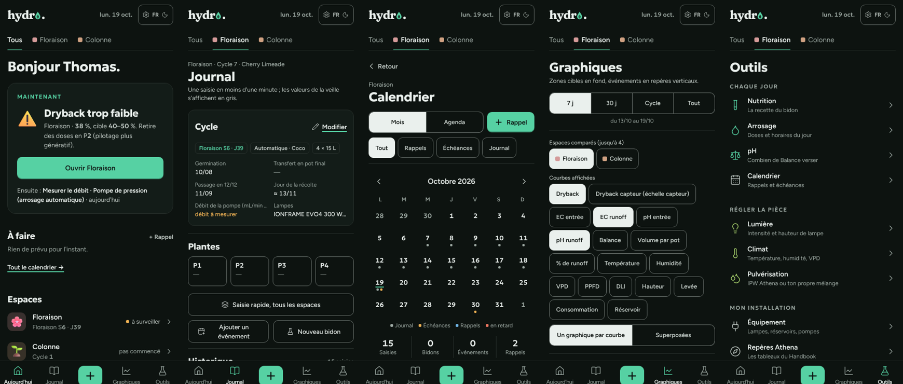
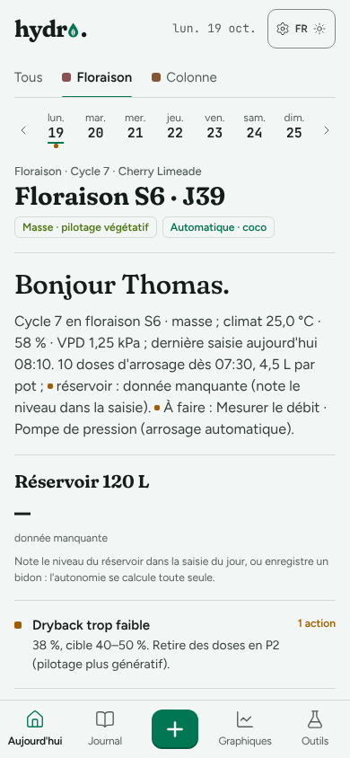
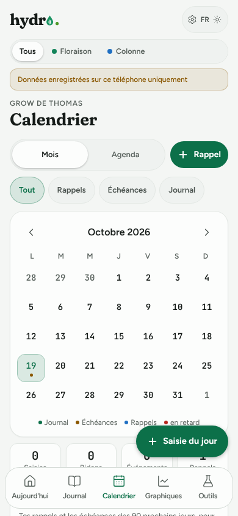
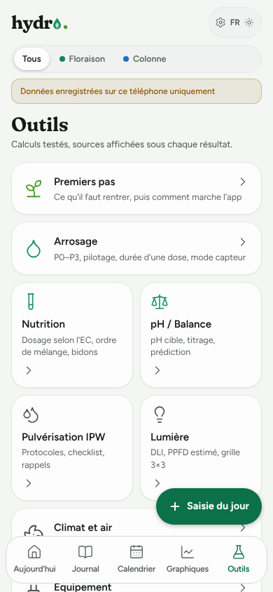

<div align="center">

# 🌱 Hydro

**Le carnet de bord de culture en intérieur, pensé pour le téléphone, dans la tente.**

Journal en une minute · Crop steering · Nutrition · Calendrier · Graphiques · Hors ligne

[](https://hydrotom.netlify.app/)


<br>



</div>

---

## Ce que fait Hydro

| | |
|---|---|
| ☀️ **Aujourd'hui** | Calme, un seul point d'entrée : « Bonjour Thomas. » puis le bloc **« Maintenant »** qui dit la chose à faire (une alerte du jour avec sa correction, la saisie pas encore faite, une échéance, sinon « Tout est à jour ») avec un seul bouton, et « Ensuite : … ». Puis **À faire** (trois tâches au plus, le reste dans le calendrier) et **une ligne par espace** : son carré de couleur avec le dessin du stade, le stade, et un seul état (« dans la cible », « bidon ≈ 1 j », « 19° · 61 % »…). Un bandeau fin et fermable suit les **Premiers pas**. **La page d'un espace** : son nom et son stade, un seul bloc encadré avec le verdict de la dernière saisie (« Tout est dans la cible » ou la correction à faire) et l'étape du cycle quand elle approche (« Passer en 12/12 · dans 2 j »), quatre **relevés** comme sur un instrument et le reste en une ligne, l'arrosage du jour en deux lignes, le réservoir, ce qu'il y a à faire ici. |
| 📓 **Journal** | Une saisie en moins d'une minute : les valeurs d'hier en fantôme (un toucher, ou « Reprendre hier »), dryback, % de runoff, VPD et DLI calculés en direct dans une bande qui reste visible, tes 4 observations et actions les plus utilisées en premier, un seul bouton « Enregistrer ». Saisie rapide de tous les espaces d'un coup. Historique **par semaines** : une carte par semaine du cycle avec la bande des 7 jours (dans la cible, hors cible, sans saisie) et seulement les jours qui comptent ; une **page par semaine** avec un verdict calculé d'après les cibles, une mini-courbe par valeur clé et une carte par jour ; recherche dans les notes et filtres (espace, plante, stade, tag). |
| 🏠 **Espaces modulables** | Tentes, rooms, serres de germination, séchoir… en nombre illimité. Chaque espace n'active que ses modules (climat, lumière, arrosage, nutrition, propagation, séchage). Plusieurs cycles en parallèle, transferts même partiels. |
| 🔌 **Équipement** | Lampes, réservoirs, pompes, extracteurs, contenants. Ils alimentent les calculs : PPFD estimé, W/m², hauteur libre, durée des doses, autonomie du réservoir, renouvellement d'air, g/W. |
| 💧 **Arrosage et crop steering** | Programme P0 → P3 ou méthode manuelle, durée de pompe à partir du débit mesuré, mode capteur. Dryback mesuré par **pesée** ou par **capteur** (échelles séparées). |
| 🧪 **Nutrition** | Athena Pro Line (et Blended), poudre ou **concentré** (113 / 226 / 282 g/L), add-ons, produits perso (dans le bidon, à la main ou sur les racines), ordre de mélange, stocks de concentré, bidons partagés entre espaces. **Autre marque** : ta propre gamme recopiée des étiquettes (1 L, 4 L, 10 L ou gallon US), le bidon calculé semaine par semaine, tes cibles d'EC et de pH seulement si tu les saisis. |
| 🌫️ **Pulvérisation** | Le protocole IPW d'Athena (fenêtre d'utilisation, dose du pulvérisateur, checklist), ou **ton propre mélange** (spray maison, stack) décrit par toi, « perso, non vérifié » : l'app calcule seulement les quantités à partir de tes doses, et met la prochaine pulvérisation au calendrier. |
| ⚖️ **pH / Balance** | pH cible selon le stade, titrage guidé, et une prédiction qui apprend de tes bidons précédents. |
| 📅 **Calendrier** | Rappels récurrents, échéances automatiques (12/12, Fade, rinçage, récolte, bidon à refaire…) et export vers le calendrier du téléphone (.ics). Il s'ouvre depuis la date en haut de l'écran, « Tout le calendrier → » d'Aujourd'hui ou Outils. |
| 📈 **Graphiques** | Vues toutes prêtes (Arrosage, Solution, Climat, Lumière, Plante, ou « Perso »), un graphique par courbe avec sa cible et la dernière valeur en grand, segments droits, bande de cible du jour, bidons en pointillé ; « Comparer… » jusqu'à 4 espaces. |
| 🌍 **Partout** | Français / anglais / allemand, thème clair / sombre, conçu pour une main et un écran de téléphone : quatre onglets en bas (Aujourd'hui, Journal, Graphiques, Outils) avec le « + » au milieu (saisie du jour, saisie rapide, bidon, événement) ; Outils rangé en trois groupes (chaque jour, la pièce, l'installation). |

<div align="center">
&nbsp;
&nbsp;

</div>

---

## Deux versions, un seul code

| | Version **Claude** | Version **locale** |
|---|---|---|
| Pour qui | Thomas | Les amis |
| Où | Artefact privé sur claude.ai | [hydrotom.netlify.app](https://hydrotom.netlify.app/), installable comme une app |
| Données | Base de l'artefact (privée, propriétaire uniquement) | Sur le téléphone (IndexedDB), **sans compte ni serveur** |
| Hors ligne | — | ✅ |
| Extras | Photos, « Demander à Claude », résumé du matin à 9 h | Sauvegarde / restauration en un fichier, export .ics |
| Build | `npm run build` → `dist/hydro.html` | `npm run build:local` → `dist-local/` |

La cible se choisit avec `VITE_TARGET=claude|local`. Les écrans et les calculs sont communs ; seule la couche de stockage change (`src/store/`).

**Mises à jour automatiques :** un push sur `main` reconstruit la version locale sur Netlify (`netlify.toml`). La version Claude est republiée sur l'artefact à la fin de chaque lot.

---

## Démarrer

```bash
npm ci
npm test                          # tous les tests (Vitest)
npm run dev                       # serveur de développement
npm run build                     # version Claude → dist/hydro.html
npm run build:local               # version locale → dist-local/
npm run preview:build             # aperçu local avec images intégrées → dist-preview/
```

Node 22 recommandé.

---

## Structure

```
src/
├── calc/          calculs purs et testés : formules, stades, cibles, arrosage, conseils, résumé du matin
├── calendar/      récurrences, échéances automatiques, agenda, export .ics
├── equipment/     calculs tirés de l'équipement (PPF, PPFD, W/m², air, doses, autonomie, g/W)
├── data/          gammes d'engrais (chaque valeur avec sa source), grow pré-rempli
├── model/         types et documents (schemaVersion sur chacun), opérations pures
├── store/         stockage : artefact Claude, IndexedDB local, mémoire pour les tests
├── i18n/          fr.ts / en.ts (clés identiques, vérifiées par un test)
├── screens/       écrans (Aujourd'hui, Journal, Calendrier, Graphiques, Outils…)
└── components/    composants UI (shadcn/ui, Magic UI)
docs/              cahier des charges, état du build, fiche Athena, guides, maquette
scripts/           images 3D, conversion artefact, captures et parcours Playwright
pwa/               manifeste, icônes et service worker de la version locale
```

---

## Les règles qui comptent

- **Aucune valeur inventée.** Chaque dose, cible ou caractéristique affiche sa source (page du Handbook, fiche fabricant, étiquette, repère courant ou estimation). Pas de source → champ vide ou « donnée manquante ».
- **Pas de mélange entre gammes.** Un test vérifie que Pro Line et Blended ne se croisent jamais.
- **Calculs hors des écrans.** Toute la logique est dans des modules purs, couverts par les tests.
- **Une saisie, moins d'une minute.** Sinon personne ne tient un journal tout un cycle.

---

## Documentation

| Document | Contenu |
|---|---|
| [`docs/etat-du-build.md`](docs/etat-du-build.md) | Lots faits, décisions, pièges connus, commandes, **prochain lot** |
| [`docs/cahier-des-charges.md`](docs/cahier-des-charges.md) | Le plan complet de l'app |
| [`docs/athena-fiche.md`](docs/athena-fiche.md) | Valeurs de nutrition Athena, avec leurs pages sources |
| [`docs/guide-amis.md`](docs/guide-amis.md) | Installer et utiliser la version locale |
| [`docs/guide-netlify.md`](docs/guide-netlify.md) | Déploiement Netlify |
| [`CHANGELOG.md`](CHANGELOG.md) | Ce qui a changé, lot par lot |
| [`CLAUDE.md`](CLAUDE.md) | Règles pour les sessions de développement avec Claude |

---

## Comment l'app est construite

Hydro est développée par lots, avec [Claude](https://claude.ai) : une session à la fois, tests verts avant chaque push, un commit par lot, et `docs/etat-du-build.md` mis à jour pour passer le relais à la session suivante.

<details>
<summary><b>Ajouter une gamme d'engrais ou un module</b></summary>

- **Gamme d'engrais** : décrire la gamme dans `src/data/nutrients/` (produits, unités, formes, programme par stade, guide par EC, ordre de mélange, règles, sources), puis l'enregistrer dans le catalogue. Le sélecteur de gamme apparaît dès qu'il y en a plusieurs.
- **Module** : ajouter son id à `MODULES` (`src/model/grow.ts`), l'inclure dans les modèles d'espace voulus, déclarer ses champs dans `MODULE_FIELDS` (`src/model/grow-ops.ts`) et ses libellés dans `fr.ts` / `en.ts` / `de.ts`. Le test i18n vérifie la parité des clés dans les trois langues.

</details>

---

<sub>Projet personnel, non affilié à Athena, AC Infinity ou Alien Hydroponics : les noms de marques appartiennent à leurs propriétaires. Les valeurs proviennent des documents publiés par les fabricants et sont citées avec leur source. Renseigne-toi sur la législation de ton pays concernant la culture.</sub>
